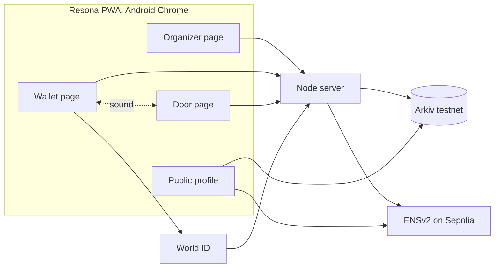

# Architecture

The sponsor tracks are decided, with implementation priority Arkiv, then ENS, then World ID. The end-to-end demo still includes all three: an ENS event page, IDKit verification and testnet purchase, followed by sonar and assigned-wallet verification at the door. The design below is proposed, and may change once the [sonar test](SONAR.md#test-plan-and-gono-go) and ENS test have real results. Track requirements are in [TRACKS.md](TRACKS.md).

## Platform decision

**For the ETHGlobal demo: a PWA on Android Chrome. For a real product: a native app.**

The team has 9 hours and 3.5 people, and a native audio module could take much of that time. The sonar doesn't need React Native to work in a demo:

- **Distance measurement works in a browser.** Each phone records its own sound, so speaker and software delay cancel out. [enconomy's web build](https://github.com/tawago/enconomy) measured [15–29 cm at about 30 cm, and 78–97 cm at 100 cm](https://github.com/tawago/enconomy/commit/9db149011e5fd77d67e16d8b5bc2c2dfca40119e), using one MacBook Air and a Pixel 6. Two Android phones in Chrome are still untested, so that's the first thing to check.
- **A Meet relay still fails,** because the honest app sees the added delay.
- **All three sponsors suit the web better.** IDKit has a React widget and no React Native SDK, Arkiv documents browser use and not React Native, and the ENS and Arkiv tracks want something judges can try from a link.
- **One TypeScript codebase** lets the whole team work on it, and deploying takes minutes.

### What the demo gives up

These are real, so state them in the pitch instead of leaving them for judges to find:

| Gap | Effect | Real product |
|---|---|---|
| A browser can't prove it's the real app | A reseller with a modified client can forge timing and beat the sonar | Android Key Attestation, Play Integrity, App Attest |
| The wallet key sits in browser storage | A streamed QR code fails without the key, but a seller could deliberately export the key and give it to a buyer | Device key in the Android Keystore or Secure Enclave |
| Session data is readable in the browser | An accomplice at the door could use it | Native memory on an attested device |
| Less audio control | Mic blocks can drop, and each 128-frame drop can shift a reading by 46 cm | Oboe and Core Audio |

enconomy's own docs reach the same conclusion: [a browser can't attest, so its web app is a demo tier](https://github.com/tawago/enconomy#limitations).

**Suggested pitch line:** "This build stops relays through the real app. Stopping a modified app needs native attestation, which is next, and the protocol is already designed for it."

## System overview



| Component | Job |
|---|---|
| **PWA** | One React app with organizer, wallet, door and profile pages. HTTPS is required for the microphone |
| **Node server** | Holds the organizer's keys, verifies World ID, coordinates check-ins through simple polling, decides pass or fail, and writes to ENS and Arkiv. Needs a long-running host, because check-in sessions live in the server's memory |
| **`sonar`** | Signal generation, matched filter and distance calculation, in TypeScript |

## What each sponsor is responsible for

| Layer | Holds | Why there |
|---|---|---|
<<<<<<< Updated upstream
| **ENSv2** | Who owns a pass, and whether the holder can transfer it | The transfer rule is enforced by the contract |
| **Arkiv** | Tickets, check-ins and hashed World ID nullifiers. It's the only database | Anyone can verify and query it without trusting our server |
| **World ID** | One claim per human per event | Stops bulk claiming without collecting identity |
| **Server environment only** | Signing keys | These must not be public. No personal details are stored at all |
=======
| **ENSv2** | Event domain and holder profile; pass ownership | The event page and wallet identity use ENS; transfer rules are later scope |
| **Arkiv** | Event, ticket and check-in data | The attendee and door views read the ticket and check-in records |
| **World ID** | One verified purchase per human per event | IDKit verification gates the testnet purchase |
| **Backend only** | World ID nullifiers, signing keys, personal details | These must not be public |
>>>>>>> Stashed changes

Once ENS is added, the door requires ENS and Arkiv to agree: the pass name's owner must match the Arkiv ticket's holder.

[BUILD_PLAN.md](BUILD_PLAN.md#build-order) has the order: sonar and Arkiv first, then World ID, then ENS.

## Keys

**Demo build:** one **wallet key**, created in the browser on first open. It proves ownership of the ticket: the holder signs each check-in report, and the server checks that the signer is the ticket's holder. This is what makes a streamed QR code fail, since the QR code identifies the ticket but doesn't prove anything. A seller could still deliberately export the key.

**Real product:** a second **device key** lives in the Android Keystore or Secure Enclave, with attestation, and signs check-ins in place of the wallet key. Phones' secure hardware generally supports P-256 but not Ethereum's secp256k1, which is why it needs to be a separate key.

## ENSv2: tickets as subnames

Target: [Best Use of ENSv2](TRACKS.md#ens). The track requires ENSv2 on mainnet or Sepolia, with its features central to the product. That rules out the offchain subnames proposed earlier. [ENSv2 contracts are on mainnet, but resolution and registration there still go through v1 until launch completes](https://docs.ens.domains/learn/deployments), so **build on Sepolia**.

**Each pass is a subname in the event's own registry,** owned by the holder's wallet:

```
ethglobal-mumbai.eth              event name, with its own registry and resolver
└── 7.ethglobal-mumbai.eth        pass 7, owned by the holder's wallet 0x7…

resona-id.eth                     people's names, in a separate registry
└── skes.resona-id.eth            a person's name, pointing at their wallet
```

This puts the brief's "only the company can allow a transfer" rule on-chain:

| Requirement | ENSv2 feature |
|---|---|
| Event has its own ticket namespace | A [UserRegistry deployed per name](https://docs.ens.domains/ensv2/permissioned-registry) through the Verifiable Factory, linked with `setSubregistry` |
| Issue a ticket | `register(label, owner, registry, resolver, roleBitmap, expiry)` |
| Non-transferable tier | Omit `ROLE_CAN_TRANSFER_ADMIN` from `roleBitmap`. [Transfers check this role on the current owner, regardless of who starts the transfer](https://docs.ens.domains/ensv2/permissioned-registry), and name-level admin roles can only be set at registration |
| Transferable tier | Include `ROLE_CAN_TRANSFER_ADMIN` |
| Organizer-approved transfer | `unregister` burns the old token, then `register` issues the pass to the new holder |
| Revoke a ticket | `unregister`, using `ROLE_UNREGISTER` |
| Holder can't edit ticket records | [Subname owners hold no roles on the parent's resolver](https://docs.ens.domains/ensv2/tutorial-app-developers/), so their writes revert |
| Door backend has limited power | [`grantSetterRoles`](https://docs.ens.domains/ensv2/permissioned-resolver/) can limit a key to one text record, such as `resona.status`, which also limits damage if that key leaks |
| Ticket ends after the event | Subname `expiry` |

Binding the pass to the wallet also keeps the earlier rule: selling a personal ENS name doesn't sell the ticket. A personal name is identity only.

**Things to check first:**

- **Namespace:** real names like `skes.eth` are on mainnet and won't exist on Sepolia. For the demo, register two Sepolia names, using the same code for both: one for the event and its passes, and one for people. Passes can then expire with the event while people's names last. Check that the names are free. Register them with [MockUSDC, whose `mint` is open on Sepolia](https://docs.ens.domains/learn/deployments).
- **Unread docs:** `/ensv2/subnames` and `/ensv2/verifiable-factory` weren't read. Confirm the subname setup steps and how the organizer gets `ROLE_REGISTRAR` and `ROLE_UNREGISTER` on the new registry.
- **Library:** the docs recommend [ENSjs 5.2.5 or later for writes](https://docs.ens.domains/ensv2/tutorial-app-developers/), and viem for reads.

**First ENS test:** on Sepolia, register an event name, deploy its registry, issue a pass without the transfer role, and try to transfer it. The transfer should revert, and that revert is also a demo moment.

## Arkiv: the ticket database

Target: [Build on Arkiv (from scratch)](TRACKS.md#arkiv). The current testnet is Rabdi, chain ID 7794095, with `@arkiv-network/sdk` and viem. The [docs](https://docs.arkiv.network) give Node 22.10+ or Bun as the runtime. **Write from the server,** because that's where the organizer's key lives. The PWA can read directly, since [a public client holds no account and is safe in the browser](https://docs.arkiv.network/start-here/clients/).

Facts that shape the design:

- **Anyone can write entities with any attributes.** Every read must filter with `.ownedBy(organizerAddress)`, or an attacker could plant a fake ticket.
- **Only the owner can patch, extend or delete,** and [the node enforces this](https://docs.arkiv.network/writing/change/).
- **Everything is public,** so no real names, emails, audio or raw nullifiers.
- **Lifetime is capped at about 182.5 days per extension,** and [expired entities stop appearing in queries](https://docs.arkiv.network/writing/expiration/). Trophies need extending, so test the `permissionlessExtension` flag, which would let holders keep theirs alive.
- **`readonly` entities can't be patched,** which suits check-in records.

| Entity | Queried by | Owner | Expiry | What the user sees |
|---|---|---|---|---|
| `resona.event` | `eventId`, `ensName` | Organizer | Event end + 30 days | Event and tier details |
| `resona.ticket` | `eventId`, `holder`, `status`, `tier` | Organizer | Event end + 30 days | Tickets in the wallet; the door's ticket lookup |
| `resona.transfer` | `passId`, `status` | Organizer | 24 hours | Pending request; lapses if nobody decides |
| `resona.checkin` | `eventId`, `holder`, `ordinal` | Organizer, `readonly` | Maximum, then extended | A link to the record after a pass, and repeat check-ins rejected. Later, the trophy and ordinal |
| `resona.claim` (stage 2) | `eventId`, `nullifierHash` | Organizer | Event end + 30 days | "Already claimed" when the same person tries again |

Proposed ticket schema, using the [documented `defineSchema` format](https://docs.arkiv.network/start-here/first-entity/):

```ts
const Ticket = defineSchema("resona.ticket", {
  passId: str().indexed(),
  eventId: str().indexed(),
  tier: str().indexed(),
  holder: addr().indexed(),
  status: str().indexed(),   // issued | claimed | skipped | checked_in | revoked
  ensName: str(),            // for example 7.ethglobal-mumbai.eth
  deviceKeyHash: str(),
  serial: str(),
})
```

Arkiv's reads power real features: the attendee's ticket view and the door lookup. The track doesn't count logging that nothing reads. Trophy pages are deferred from the demo.

## World ID: one claim per human

Target: [Best Use of IDKit](TRACKS.md#world). The trust moment is **claiming a scarce or discounted ticket**, which is the track's own "fair access to a scarce benefit" example.

- **Credential: [Proof of Human](https://docs.world.org/world-id/idkit/credentials) to start.** The only thing we need to know is that this is a unique person, and age or nationality would collect more than necessary. The track rewards choosing the minimum sufficient credential. [Organizer-selected levels](PRODUCT.md#verification-levels) come later.
- **Action:** `claim-<eventId>`, so one person gets one claim per event, unlinkable across events.
- **Signal:** the wallet address, so a proof can't be replayed for a different wallet. The backend checks that the value matches.
- **Backend:** sign the request with `signRequest`, forward the proof to [`POST /api/v4/verify/{rp_id}`](https://docs.world.org/world-id/idkit/integrate), then look for its hash in `resona.claim` on Arkiv, using a hash that includes the event ID. The Portal only checks the proof's validity, so **our backend must reject duplicates**. Handle claims one at a time, because a new Arkiv record takes a block to appear, and two quick claims could otherwise both pass.
- **Alternative path for the demo:** a second claim by the same person is rejected as an ineligible user.
- **Testing:** the [simulator](https://simulator.worldcoin.org/) with `environment: "staging"`. A live deployment should reject non-production proofs.

**Route:** the `@worldcoin/idkit` React widget in the PWA, with `signRequest` and verification on the server.

## Trophies

Stage 4. Trophy pages read `resona.checkin` from Arkiv and the holder's name and avatar from ENS, with a short hash and the ordinal. [POAP's mint links need a review](https://documentation.poap.tech/docs/popular-flow), so request them early.

## Repo layout

```
app/               React PWA
  src/pages/       Organizer, wallet, door and profile pages
  src/sonar/       Signal generation, matched filter, distance math, audio worklet
server/            Node: serves the app, check-in sessions, ENS, Arkiv, World ID
arkiv/             Files required by the Arkiv track
docs/
```

## Build plan

<<<<<<< Updated upstream
Phases, roles and the cut list are in [BUILD_PLAN.md](BUILD_PLAN.md).
=======
| Who | Job |
|---|---|
| **A: Sonar** | Audio capture, matched filter, distance, door and wallet check-in screens |
| **B: Chain** | Node server, ENSv2 passes, Arkiv entities |
| **C: App** | ENS event page, testnet purchase, IDKit verification and attendee/door views |
| **0.5: Submission** | Arkiv files, friction log, World debrief, license, README, demo video, and being the second phone tester |

| By hour | A: Sonar | B: Chain | C: App | Checkpoint |
|---|---|---|---|---|
| **2** | Two phones in Chrome give a distance | First Arkiv write and read | Deployed HTTPS shell; first World ID success in the simulator | **Go/no-go on sonar; preserve time for Arkiv** |
| **5** | Sonar check-in over WebSocket | Ticket and check-in entities, ENS event and pass | ENS event page, IDKit purchase, attendee and door views | **Testnet purchase-to-check-in happy path works** |
| **7** | Remote relay and noise tests; tune | Validate ENS ownership against Arkiv ticket; complete visible Arkiv reads | Duplicate verification rejection; refine profiles | **Feature freeze** |
| **8** | Rehearse on the real phones | Fix demo blockers | Fix demo blockers | **Video recorded** |
| **9** | Buffer | Buffer | Buffer | **Submit with time to spare** |

**If behind, cut in this order:** trophy page, transfer flow, purchase page styling, then optional device-key signature. Keep a basic ENS event page and testnet purchase in the happy path.

**Never cut:** the sonar check-in, the specific-wallet check at the door, an Arkiv read visible to users, the ENS event page, IDKit verification in the testnet purchase flow, the track files and the video.

**Demo scope:** false sonar rejections and manual overrides are not modeled in the demo. Phone lending is also out of scope; the stated claim is proximity plus presence of the ticket's assigned wallet, not proof of the person holding the phone.

**Technical contingencies:**

- **Two phones won't range in Chrome by hour 2:** use a laptop as the door device, which is the pairing enconomy tested. A laptop at the door also looks natural.
- **Reading is unstable:** show the median of up to 3 attempts, and hold the phones closer.
- **Meet removes the signal entirely:** the relay still fails, and the screen shows "partner sound not found" instead of a large distance. Both results are fine for the demo.
>>>>>>> Stashed changes
