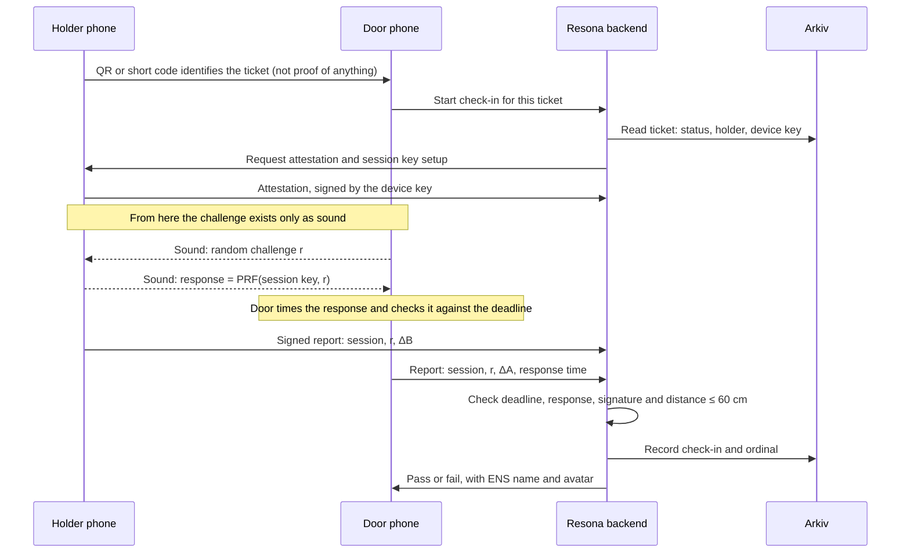

# Sonar check-in

This is the core of the project. All numbers here are calculated or proposed, and none has been measured on our phones yet.

## Prior work

- **[tawago/enconomy](https://github.com/tawago/enconomy)** is very close to this design: two-way timing, a matched filter, a 60 cm line, and ENS and World ID on Sepolia, with a browser build. Its lessons are used below. **It has no license, so all rights are reserved, and the Arkiv track requires building from scratch. Learn from its ideas and don't copy its code.** It was updated today, and we couldn't tell whether it's also entered here, so Resona's pitch should rest on the ticketing product.
- **[michaelneri/audio-distance-estimation](https://github.com/michaelneri/audio-distance-estimation)** isn't useful here. It's a machine learning research project that estimates how far a talker is from one microphone using room reverberation. It relies on trained models and offers no way to detect a relay. We read only its README and file list.

## Demo protocol (ETHGlobal build)

This is simpler than the full protocol below. It has no response deadline and no attestation, so it stops relays through the real app but not a modified client.

1. The holder's phone shows a QR code that identifies the ticket, and the door scans it.
2. The server checks the ticket in Arkiv and ENS, and creates a session with a fresh random seed.
3. Both phones derive two 250 ms signals from the seed, one per role, so old recordings can't be replayed.
4. The server tells both phones to start. Both are already recording.
5. The door plays its signal about 0.5 s later, and the holder plays about 1.5 s later. Exact timing doesn't matter, because the recordings are searched for both sounds. Record for about 5 s, to leave room for relay delay.
6. Each phone finds both arrivals with a matched filter, and sends its elapsed time to the server. The holder signs its report.
7. The server computes the distance. **Pass** means under 60 cm, with the ENS name and avatar shown. The check-in goes to Arkiv.

Demo at about **30 cm**, not arm's length. enconomy's data shows [handheld phones at 60 cm reading 60–90 cm](https://github.com/tawago/enconomy#limitations), so a real 60 cm would often fail. Touching phones read about 8 cm rather than zero, because of speaker-to-mic spacing. Its evidence is still limited to quiet-room sessions, so our own noise test matters.

**Signal:** use noise-like codes across 2–18 kHz, as enconomy does, rather than the 17–20 kHz chirps proposed below. A wide band gives sharper timing and survives phone speakers better. It's audible, which is fine at a demo and tells people a check is running.

**Browser audio rules:**

- Use one 48 kHz `AudioContext`, started from a tap.
- Request the mic with echo cancellation, noise suppression and auto gain **off**. Check `getSettings()`, and refuse to run if they stay on.
- Capture raw samples in an AudioWorklet, and number every block using the context's frame count. A gap near the sounds means retry, since [one lost 128-frame block is worth 46 cm](https://github.com/tawago/enconomy/commit/9db149011e5fd77d67e16d8b5bc2c2dfca40119e).
- Do as little as possible on the audio callback. enconomy found frequent clock reads caused drops on a MacBook.
- Keep a very quiet constant signal playing. enconomy saw output delay drift after silence, with the cause unconfirmed.
- Use the built-in speaker at full volume, and hold a Wake Lock so the screen stays on.
- Take the first strong peak, not the largest.

## The idea

The two phones play sounds to each other and record at the same time. Sound travels at about 343 m/s, so distance shows up as time. Sending that sound through an internet relay adds delay, and the delay looks like distance.

## Measuring distance without synced clocks

The phones don't share a clock, and neither knows how long its own speaker takes to start playing. The [BeepBeep](https://www.microsoft.com/en-us/research/?p=155459) method avoids both problems. **Each phone records its own sound as well as the other phone's**, then counts audio samples between the two. Software delays happen before the sound reaches the microphone, so they cancel out.

```
A = door phone, B = holder's phone

ΔA = time on A's recording between A's own sound and B's sound
ΔB = time on B's recording between A's sound and B's own sound

distance = (c / 2) × (ΔA − ΔB) + (dAA + dBB) / 2
```

`c` is the speed of sound. `dAA` and `dBB` are the speaker-to-microphone distances on each phone, which are fixed offsets to calibrate.

| Quantity | Value |
|---|---|
| One sample at 48 kHz | about 3.6 mm of calculated distance |
| 60 cm threshold | 3.5 ms round trip, or about 168 samples of `ΔA − ΔB` |
| Clock drift at 50 ppm over 100 ms | under 2 mm |
| Temperature (20 °C to 30 °C) | about 2% change in `c`, about 1 cm at 60 cm |

Published BeepBeep results report about [2 cm average accuracy on ordinary phones](https://microsoft.com/en-us/research/wp-content/uploads/2007/11/demo_sensys07_beepbeep.pdf), so 60 cm leaves a generous margin in principle. A noisy venue will be harder than those tests.

## What a relay does to the result

If both phones run our real app and the sound passes through a relay, the extra delay `L` adds directly:

```
apparent distance = (c / 2) × L        L = total round-trip relay delay
```

| Round-trip relay delay | Apparent distance |
|---|---|
| 3.5 ms | 60 cm |
| 20 ms | 3.4 m |
| 50 ms | 8.6 m |
| 100 ms | 17 m |
| 200 ms | 34 m |
| 400 ms | 69 m |

These delays are illustrative. We need to measure real Google Meet and Discord delay, and whether those apps pass our signal at all, since voice processing may remove it.

## Timing comes from matched filtering, not histograms

The brief suggested matching the sounds using their histograms. A histogram or spectrogram can recognize a sound but can't time it finely enough. One 1024-sample analysis frame at 48 kHz lasts 21 ms, which equals 7 m of sound travel.

- **For timing:** use a matched filter, which slides the known signal across the recording and finds the exact sample where it lines up. Take the *first* strong peak, because later peaks are usually reflections.
- **Where spectrograms still help:** as a live visual in the demo, and possibly as a same-room check. [DoubleEcho](https://arxiv.org/pdf/1803.07211.pdf) uses room acoustics to check that two devices are together.

## The gap: a modified app can lie

The calculation above trusts the `ΔB` the holder's phone reports. A reseller who builds a modified client can defeat it:

1. An accomplice stands at the door with a phone, and the real holder is at home.
2. The accomplice's phone hears both sounds directly, so it knows `ΔA` exactly.
3. The home phone reports a forged `ΔB` that makes the distance look like 10 cm.

Distance-bounding research calls a colluding version of this a *terrorist fraud*, and that matches our case because the ticket holder is the one cheating. [Clulow et al.](https://www.rfidblog.org.uk/esas2006-distance.pdf) also warn that acoustic ranging is exposed to relays over faster channels. So sound alone is not enough, and the protocol needs two more things:

1. **A deadline the door measures alone.** The response depends on a random challenge that exists only as sound. It can't be sent early, and the door times it without trusting anything the holder says.
2. **Proof that the responder is our real app on a real phone.** This uses App Attest on iOS and Play Integrity on Android, along with a key that can't leave the phone. A browser can do neither, which is the main gap in the [demo build](ARCHITECTURE.md#what-the-demo-gives-up).

This gives two bounds:

| Bound | Trusts the holder's phone? | Precision | Stops |
|---|---|---|---|
| **Deadline** | No | Coarse, limited by the slowest allowed phone | Consumer relays such as Meet and Discord, even with a modified client |
| **BeepBeep distance** | Yes, so it requires attestation | About 60 cm or better | Slipping through from across the room or the venue |

## Full protocol (after the hackathon)



Rules that matter:

- **The challenge never crosses the network** before it is played. Otherwise a remote phone could respond in time.
- **Respond as fast as possible.** A phone that takes longer than the deadline for its device class fails.
- **Report only after the sound exchange, and keep the recordings on the phones.** Only timing values leave the device.
- **Limit attempts,** for example 3 per session. With a 16-bit response, one blind guess succeeds 1 time in 65,536.
- **Use different signals per door** so neighbouring lanes don't confuse each other.

Starting values to tune during the spike:

| Parameter | Starting value |
|---|---|
| Signal | Chirps in the 17–20 kHz range, with an audible fallback |
| Challenge and response | 4 symbols of 10 ms, each picked from a set of 16 (16 bits) |
| Distance threshold | 60 cm, including calibration offsets |
| Response deadline | Set per device class from measurements, with 150 ms as a placeholder |
| Time at the door | Under 5 seconds |

The tighter the deadline, the less room an attacker has. On Android, [Oboe's docs treat 20 ms or less round trip as pro-audio](https://android.googlesource.com/platform/external/oboe/+/ba2fb95054ea5cea728f1ec320e882b471e7ba15/apps/OboeTester/docs/AutomatedTesting.md), but many phones will be slower.

## Threat model

This table describes the full protocol. **In the demo build, nothing relying on attestation or a hardware key is actually blocked:** forged timing, shared session keys and custom relays would all succeed against a modified client.

| Attack | What the attacker does | Result | Defence |
|---|---|---|---|
| QR streaming | Shows the code over a video call | Blocked | QR only identifies the ticket; sound is still required |
| Screenshot or forwarded ticket | Sends a copy to a buyer | Blocked | The buyer's phone lacks the device key |
| Bluetooth relay | Forwards radio traffic | Not applicable | We don't use radio for proximity |
| Audio over Meet or Discord | Relays sound with our real app | Blocked | Apparent distance is many metres, and the deadline is missed |
| Replay | Records a past exchange and plays it back | Blocked | The challenge is fresh each time |
| Forged `ΔB` with a modified client | Lies about timing | Blocked if attestation holds | Attestation, plus the door's own deadline |
| Custom fast relay | Builds a low-latency relay, possibly in the same city | **Harder, not impossible** | Tight per-device deadline and attestation; test how tight we can go |
| Seller shares the session key with an accomplice | Accomplice answers in time at the door | Blocked if attestation holds | Session key stays in the attested app's native memory |
| Seller shares the account or seed | Buyer logs in on their own phone, and there's no relay to detect | Blocked by key binding | Ticket is tied to a hardware key; re-binding needs the organizer and World ID |
| Rooted phone that spoofs attestation | Defeats integrity checks | **Possible, costly** | Keep attestation current and watch for anomalies |
| Lending or posting the unlocked phone | Physically hands over the real device | **Not stopped** | ENS avatar on the staff screen and optional ID check; the seller also gives up their phone |
| Bot farm | Buys many tickets | Reduced | One World ID per event; rented IDs remain possible |

## Engineering risks to test

- **Audio processing:** echo cancellation, noise suppression and automatic gain can remove or shift our signal, so they must be turned off. Near-ultrasonic response also differs by phone ([SonicPACT](https://arxiv.org/pdf/2012.04770) explores this for contact tracing).
- **Noise:** check-in lines are loud, and the microphone or speaker may be blocked by a hand or case.
- **Self-saturation:** a phone's own speaker can overload its microphone, hiding a quieter signal that follows.
- **Reflections:** nearby surfaces and hands create false peaks.
- **Gaps in recording:** one dropped audio buffer ruins the sample count, so dropped frames must be detected and the attempt retried.
- **Geometry:** speaker and microphone placement varies, which can account for several centimetres on each phone.

## Test plan and go/no-go

Run this first, because the rest of the product depends on it. The go/no-go is at hour 2 of the [9-hour plan](ARCHITECTURE.md#9-hour-plan-for-35-people). The demo needs the ranging, noise, phone-pair and relay tests, and the others apply to the full protocol.

| Test | Pass condition (proposed) |
|---|---|
| Ranging at 10, 30, 100 and 300 cm in a quiet room | 30 cm always passes; 100 cm and beyond always fails |
| Same distances with crowd noise at realistic volume | Same result within 2 tries |
| The team's two Android phones | Same result with either phone as the door |
| Relay through Google Meet and Discord | Always fails; apparent distance never under 5 m |
| Response time, 50 runs per phone | Honest phones meet a deadline shorter than the measured Meet relay |
| Modified client forging `ΔB` | Rejected by attestation and the deadline |

**If ranging fails in noise:** use an audible signal and a closer tap distance. **If the deadline can't be set below relay delay:** the claim becomes "stops consumer relays only", and the docs and pitch must say so.

## Why not other radios

- **NFC:** [Web NFC exists only in Chrome-family Android browsers, and Safari opposes it](https://caniuse.com/webnfc). Native NFC access on iOS is restricted, and NFC can also be relayed.
- **Bluetooth (classic RSSI proximity):** it estimates distance from signal strength, which a relay can fake. Newer [Bluetooth Channel Sounding](https://www.imec-int.com/en/articles/discover-bluetooth-channel-sounding-leap-forward-ranging-accuracy) is much stronger, but needs newer hardware.
- **UWB:** built for secure ranging, but only on a subset of phones.

Sound works today on every phone with a speaker and microphone, which is Resona's reason to exist. If secure radio ranging becomes common, it could become a stronger second signal.
